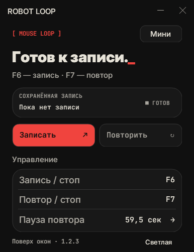

# Robot Loop

Небольшое нативное приложение для Windows: записывает движения и клики мыши и воспроизводит их по кругу с заданной паузой. Окно поверх остальных, тёмная и светлая темы, компактный режим только с таймером.

**[Скачать установщик](https://github.com/cveloy102/robot-loop/releases/latest)** · Windows 10/11 x64 · .NET включён в сборку



## Управление

| Действие | По умолчанию |
| --- | --- |
| Начать / закончить запись | **F6** |
| Запустить / остановить повтор | **F7** |
| Изменить горячую клавишу | Нажать строку записи или повтора, затем нужную комбинацию |
| Изменить паузу | Нажать строку «Пауза повтора» |
| Открыть мини-таймер | Нажать «Мини» |

Бинды глобальные, в том числе при работе поверх клиента удалённого рабочего стола. Поддерживаются комбинации с Ctrl, Alt и Shift; Esc отменяет выбор. Прямой перехват клавиш работает в отдельном потоке и обновляется при смене активного окна и периодически. Работа поверх конкретного клиента удалённого доступа зависит от того, как он обрабатывает клавиатуру.

Записываются левая, правая, средняя и боковые кнопки, колесо и движения мыши на нескольких мониторах. Сохраняется время действий; после записи выдерживается пауза 0–86400 секунд и начинается следующий цикл. Движения записываются с частотой до 125 Гц. Перед запуском записи и первым повтором есть задержка 350 мс, чтобы отпустить кнопку запуска. При остановке воспроизведение отпускает зажатые им кнопки.

В мини-режиме остаётся только время. Щелчок по нему меняет паузу; Enter сохраняет, Esc отменяет, уход в другое окно сохраняет. Плашку можно перетаскивать. Правый клик → «Открыть полное окно» возвращает основной интерфейс. Изменение паузы действует на текущее ожидание.

## Установка и ограничения

Установщик размещает приложение для текущего пользователя без прав администратора. Можно выбрать папку, создать ярлыки; удаление доступно в настройках приложений Windows. Для переносного запуска скачайте архив portable из релиза, распакуйте и запустите `RobotLoop.exe`.

- Запись хранится в памяти до закрытия приложения. Клавиатура не записывается.
- Координаты абсолютные: при изменении положения окон или мониторов запишите макрос заново.
- Для управления окнами, запущенными администратором, Robot Loop тоже потребуется запустить администратором.
- Установщик и приложение не подписаны цифровым сертификатом.

Настройки и тема сохраняются в `%LOCALAPPDATA%\RobotLoop\settings.json`. Диагностический журнал — `diagnostics.log` в той же папке: до 128 КБ плюс предыдущий файл. Координаты мыши и ввод клавиатуры в журнал не записываются.

## Сборка

Требуется .NET 10 SDK на Windows.

```powershell
dotnet build RobotLoop.csproj -c Release
dotnet publish RobotLoop.csproj -c Release -r win-x64 --self-contained true -p:PublishSingleFile=true -o dist
```

Результат: автономный `dist\RobotLoop.exe`. Установка .NET на целевом компьютере не требуется.

Для сборки установщика нужен компилятор Inno Setup:

```powershell
powershell -NoProfile -ExecutionPolicy Bypass -File tools\build.ps1 -Compiler "C:\Program Files\Inno Setup 7\ISCC.exe"
```

Скрипт запускает проверки, собирает приложение и `dist\RobotLoop-Setup-1.2.3.exe`. Компилятор установщика не включён в репозиторий.

## Проверки

```powershell
dotnet run --project tests\RobotLoop.Checks.csproj -c Release
dotnet run --project tests\RobotLoop.Checks.csproj -c Release -- --soak
dotnet run --project tests\RobotLoop.Checks.csproj -c Release -- --ui-chrome
```

Проверки мыши используют подмену отправки ввода и не двигают реальный курсор. `--soak` проверяет продолжительное воспроизведение и восстановление перехвата. `--ui-chrome` кратковременно открывает тестовые окна без регистрации биндов и проверяет собственную панель после смены темы, скрытия, пересоздания HWND, восстановления и диалогов, а также увеличенные компоновки на 125% и 150%.

`tests\check-installer.ps1` проверяет установку и удаление в тестовой папке. Он отказывается работать, если приложение уже установлено или запущено, чтобы сохранить существующую установку.

## Ресурсы

Иконки в `assets` доступны в SVG, PNG 1024×1024 и многоразмерном ICO. Выбрана иконка с курсором в петле. Генерация: `python tools\render_icons.py`.

Шрифты Inter и JetBrains Mono встроены в приложение. Статические варианты для GDI находятся в `assets/fonts`, исходные — в `assets/fonts/source`. Повторная подготовка: `python tools\prepare_fonts.py`. Необязательные зависимости для генерации ресурсов: `pip install -r tools\requirements-assets.txt`.

Лицензия шрифтов — [SIL Open Font License](assets/fonts/OFL.txt). Она также включена в установщик.
